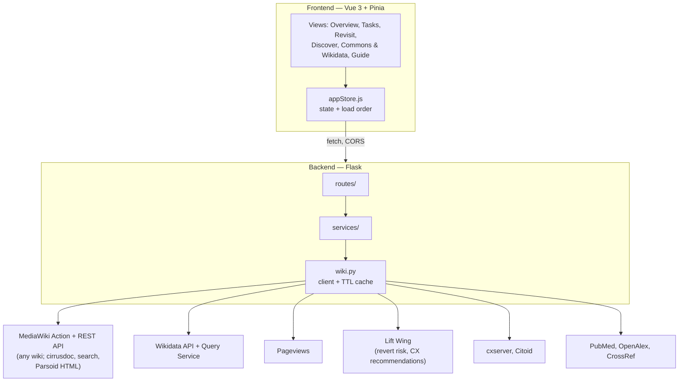
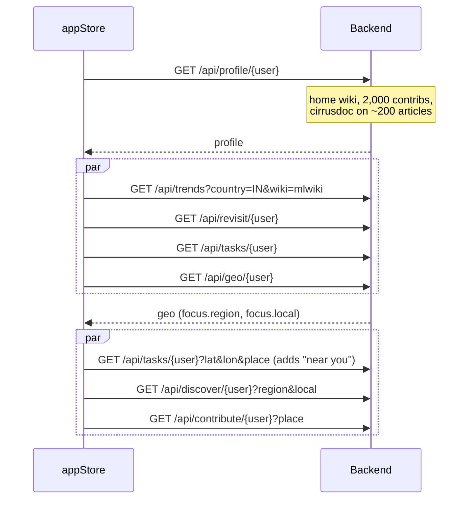

# Architecture

## Design principles

1. **Any wiki, not just English.** Every service takes a `dbname`. The editor's home wiki (most edits) is the default, so a Malayalam, Tamil or Swedish editor gets results from their own Wikipedia.
2. **Use Wikipedia's own signals.** Topics, countries, quality, maintenance tags and recommendations come from what Wikimedia already computes: ML labels in the search index (`cirrusdoc`), tracking categories, PageAssessments, Growth suggestions and Lift Wing models. There are no keyword lists.
3. **Routes are thin, services are thick.** `routes/` parses parameters and serialises JSON. All logic is in `services/`.
4. **One client, one cache.** All HTTP goes through `services/wiki.py`, which handles User-Agent, retries, POST batching and per-wiki hosts. Results are cached with a TTL, in memory and in a SQLite file (`COMPASS_CACHE_PATH`), so restarts and other workers start warm.
5. **Say when something failed.** Sub-source failures are reported as `partial: true` (with `failed`) instead of silently becoming empty lists.

---

## System overview

---

## Backend module map

| Module | Responsibility |
|---|---|
| `app.py` | App factory. Auto-registers every blueprint in `routes/`. Config through env vars (`FLASK_DEBUG`, `COMPASS_HOST`, `COMPASS_PORT`, `COMPASS_CORS_ORIGINS`). |
| `services/wiki.py` | The HTTP client: `api(dbname, params, post)`, `api_pages` (50-title batches over POST), `search`, `get_json`/`post_json`, host and URL helpers, and `TTLCache` (thread-safe, with per-key compute locks; named caches are also written to SQLite). |
| `services/signals.py` | Per-article signals from `prop=cirrusdoc|pageassessments|info`: ML topics and country, Growth recommendations, popularity, incoming links, size, coordinates, categories, templates, quality class, protection. Cached 24 h. |
| `services/maintenance.py` | Maintenance issues on any wiki. English tracking categories and templates are mapped to local names through interlanguage links. `issues_of(sig)` and `search_filter(key)`. |
| `services/profile_service.py` | Home wiki, contributions, creations, Babel, topic/country aggregation, edit types from tags, reverted-by-others. Cached 6 h. |
| `services/task_service.py` | Candidate search (scope × filter), signal-based ranking, pageviews, diversification. |
| `services/geo_service.py` | Wikidata P131 hierarchy walk with ranks and P576 handling; focus selection. |
| `services/revisit_service.py` | Tags on the editor's own articles, with dates; new since last edit; revert risk of the latest edit. |
| `services/discover_service.py` | CX recommendation API (articles, sections) and WDQS region gaps. |
| `services/crossproject_service.py` | Unused Commons uploads, Wikidata label/description gaps, CampaignEvents. |
| `services/article_service.py` | Parsoid HTML analysis, Wikidata comparison, missing sections via cxserver. |
| `services/references_service.py` | Topic-routed PubMed/OpenAlex/CrossRef search, Citoid citations. |
| `services/trends_service.py` | `top-per-country` and per-wiki top articles filtered to those needing work; Current events headlines. |
| `data/countries.json` | Country name (as the article-country model labels them) → ISO alpha-2, alpha-3 and QID. Generated from Wikidata (P297/P298, no P576). |

---

## Request flow

The profile is cached, so the parallel calls reuse it rather than fetching contributions again. `sessionSeq` and `tasksRequestSeq` stop a slow response for an earlier user, or an earlier wiki, from overwriting a newer one. See [[Frontend-State]].

---

## Error handling

| Layer | Convention |
|---|---|
| Route | `ValueError` → 404 (no such account or no edits); other exceptions → 500 `{"error": …}` |
| Service (sub-source) | Catch, record in `failed`, set `partial: true`, and continue |
| Frontend | Per-feature `*Error` state; a warning banner when `partial` is set |
