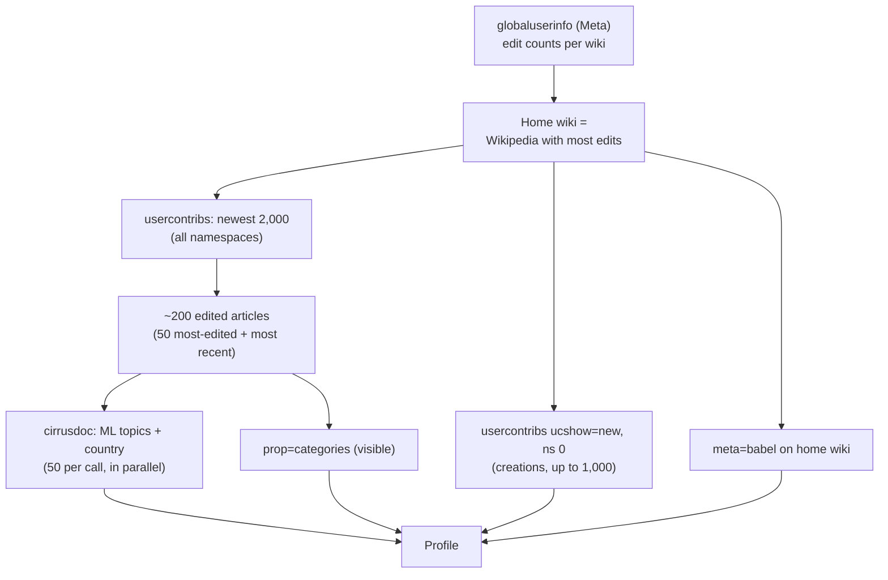

# Feature: Editor Profile

**Endpoint:** `GET /api/profile/<username>[?wiki=dbname]`
**Service:** `services/profile_service.py`
**UI:** Overview

Answers: *where does this editor work, and on what?* Every other feature uses this profile.

---

## Steps

| Step | API | Why |
|---|---|---|
| Home wiki | `meta=globaluserinfo&guiprop=merged` | Most target editors work mainly outside enwiki. Wikidata, Commons, test wikis, `abstractwiki` and non-Wikipedia projects are excluded. |
| Contributions | `list=usercontribs`, 4 × 500 | 2,000 is enough for topics; v1 fetched 20,000 in 40 calls |
| Creations | `list=usercontribs&ucshow=new&ucnamespace=0` | Exact. v1 guessed from edit summaries (it found 20 of Netha Hussain's 648). |
| Topics and countries | `prop=cirrusdoc&cdincludes=weighted_tags` | Wikipedia's own ML labels (`articletopic`, `articlecountry`), available on every Wikipedia |
| Categories | `prop=categories&clshow=!hidden` | For "in a category you edit" tasks. Tracking categories (by pattern), "Living people" (mapped per wiki) and categories over 5,000 pages are dropped. |
| Languages | `meta=babel` plus wikis with ≥ 100 edits | Babel level 0/1 is ignored |

## Topics

Each edited article has topic weights, e.g. `Culture.Media.Films|996`. Compass sums them over the edited articles and divides by the article count, giving a share. Topics with ≥ 5% share are kept, and regional topics (`Geography.Regions.*`) are reported separately as `regions`. A topic's `slug` (e.g. `films`, `medicine-and-health`) works directly as CirrusSearch's `articletopic:` keyword.

Examples (October 2026):

| Editor | Topics |
|---|---|
| Hog Farm (enwiki) | Military and warfare 60%, Transportation 24% · United States |
| Ranjithsiji (mlwiki) | Media 22%, Biography 21%, Films 19% · India |
| Netha Hussain (enwiki) | Biography 25%, Food and drink 22%, STEM 15%, Medicine & Health 9% · India |

## Countries

Country names come from the article-country model ("India") and are mapped to ISO codes through `data/countries.json`. `a3` is used for `articlecountry:` search and `a2` for regional pageviews.

## Edit types

`classify_edit()` reads MediaWiki **change tags** first, because they don't depend on language:
- `mw-undo`/`mw-rollback`/`mw-manual-revert` → `revert`
- `contenttranslation*` → `translation`
- `newcomer task*` → `newcomer_task`
- `mw-new-redirect` → `redirect`
- `editcheck-newreference` → `references`

Then it checks the namespace (talk, category, file, template). After that it falls back to English edit-summary patterns and the size of the change.

## Reverted by others

Replaces v1's `qualityTier`, which counted the editor's *own* reverts and therefore rated vandal fighters as "developing". An article edit counts as reverted if it carries `mw-reverted` and the editor's own next edit on that page is not a revert (that would be a self-revert).

## Caching

The profile is cached for 6 h per `(username, wiki)`, with a per-key lock so the dashboard's parallel requests compute it only once.
