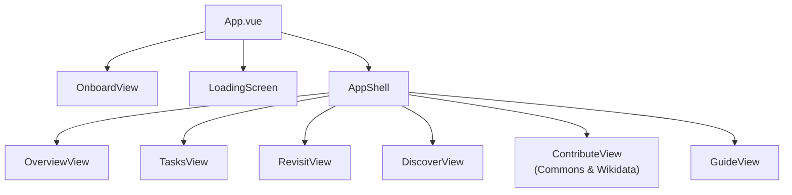
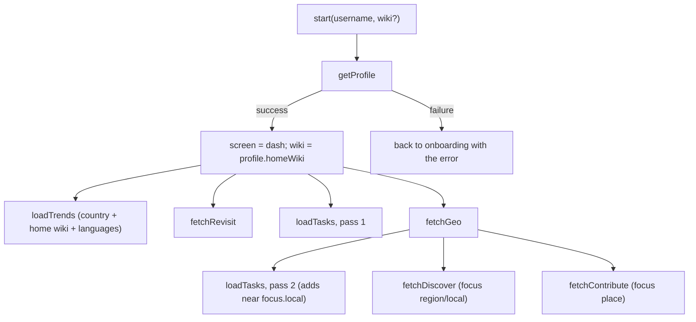

# Frontend State

**Store:** `frontend/src/stores/appStore.js` (Pinia)
**API layer:** `frontend/src/api.js`

There is one store and one API module. Components never call `fetch` directly, with one intentional exception: the Guide view, whose data belongs to each search rather than to the app.

---

## Component tree

## State shape

| Group | Fields |
|---|---|
| Session | `screen`, `username`, `onboardError`, `activeView`, `wiki` (null = home wiki), `sessionSeq` |
| Profile | `profile`, which gates the transition out of onboarding |
| Trends | `trends`, `trendsLoading` |
| Tasks | `tasks`, `tasksMeta` (`scopes`, `candidates`, `partial`), `tasksLoading`, `tasksError`, `tasksRequestSeq` |
| Revisit | `revisit`, `revisitLoading`, `revisitError` |
| Geo | `geo`, `geoLoading`, `geoError` |
| Discover | `discover`, `discoverLoading`, `discoverError` |
| Contribute | `contribute`, `contributeLoading`, `contributeError` |
| Guide | `guideQuery`, `guideWiki`, `guideQuerySeq` |

## Getters

| Getter | Value |
|---|---|
| `homeWiki` | `profile.homeWiki` |
| `geoLocal` / `geoRegion` | `geo.focus.local` / `geo.focus.region`, which the backend chooses from counts |
| `countryA2` | `profile.countries[0].a2`, for regional trends |

v1's `geoFocusName` getter (the first non-country place in list order) and `topEditTypes` were removed. The backend now chooses the focus from counts and reads edit types from the cached profile.

## Load order

**Two sequence guards:**
- `tasksRequestSeq`: only the newest task request's response is applied.
- `sessionSeq`: every request captures it, and a response is dropped if the user or wiki changed in the meantime ("New user", or switching wiki).

## Actions

| Action | Behavior |
|---|---|
| `start(username, wiki)` | Reset, fetch profile, fan out |
| `switchWiki(dbname)` | Restart on another of the editor's Wikipedias, keeping the current view |
| `loadTrends`, `loadTasks`, `fetchRevisit`, `fetchGeo`, `fetchDiscover`, `fetchContribute` | Each has its own loading and error state. `fetchGeo` triggers task pass 2, Discover and Contribute. |
| `searchGuide(title, wiki)` | Open the Guide for an article on a given wiki. Task and Revisit cards call it. |
| `logout()` | Reset to onboarding and bump `sessionSeq` |

## API layer

`api.js` has one `get(path, params, label)` helper. It drops empty parameters and turns a non-OK response into an `Error` carrying the backend's `error` message. `API_BASE` comes from `import.meta.env.VITE_API_BASE` (default `http://127.0.0.1:5000`).

## UI conventions

- Wikimedia Codex components throughout.
- Links come from the backend (`url`, `editUrl`, `translateUrl`), so they point to the right wiki. Nothing in the views hard-codes `en.wikipedia.org`.
- Filters are client-side and built from the data actually present.
- A warning banner appears whenever a response has `partial: true`.
