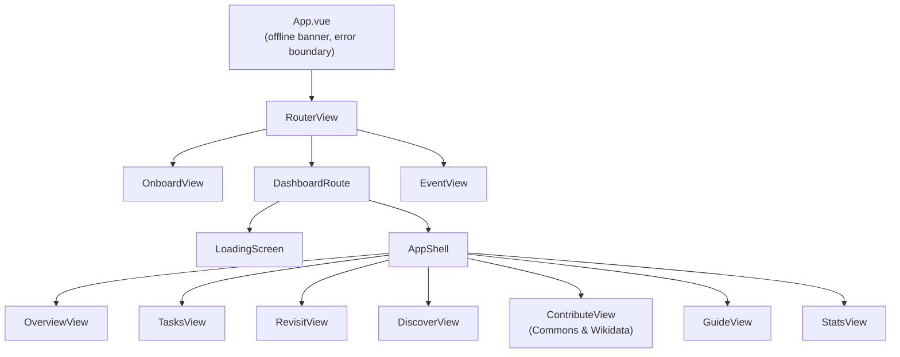
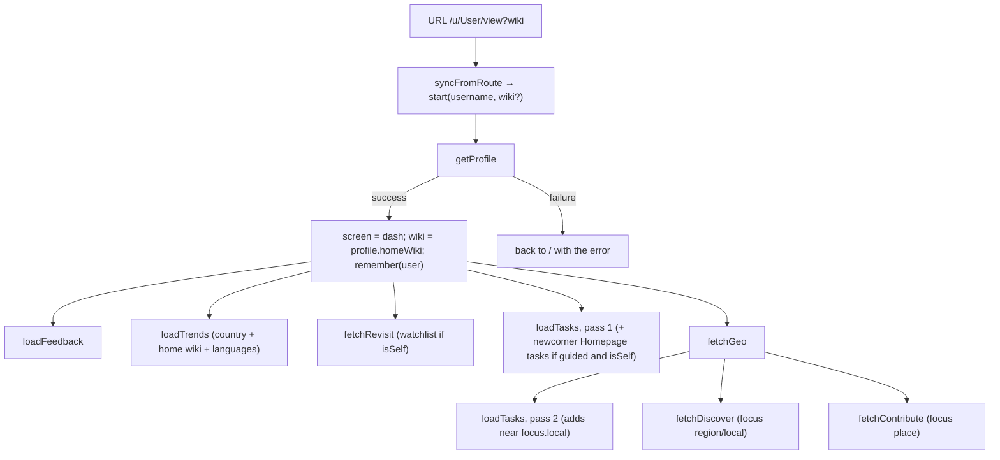

# Frontend State

**Store:** `frontend/src/stores/appStore.js` (Pinia)
**Router:** `frontend/src/router.js` (vue-router)
**API layer:** `frontend/src/api.js`
**Messages:** `frontend/src/locales/en.json` (vue-i18n, set up in `i18n.js`)
**Theme:** `frontend/src/theme.js`

There is one store and one API module. Components never call `fetch` directly, with two intentional exceptions: the Guide view, whose data belongs to each search rather than to the app, and the event page, which lives outside an editor's session.

---

## URLs

Every screen has a URL, so refreshing keeps your place and links can be shared:

| URL | Screen |
|---|---|
| `/` | Start screen, with recently viewed editors (kept in `localStorage`) |
| `/u/<User_name>/<view>?wiki=<dbname>` | A dashboard view. `view` is one of `tasks`, `revisit`, `discover`, `contribute`, `guide`, `stats` (empty = overview). Without `wiki`, the home wiki |
| `/u/<User_name>/guide?article=<title>&articleWiki=<dbname>` | The Guide with an article loaded |
| `/event`, `/event/<id>?user=<User_name>&wiki=<dbname>` | An Event Registration worklist, ranked for one editor |

**The URL is the source of truth.** Navigation actions (`open`, `goTo`, `switchWiki`, `searchGuide`, `logout`) only push a route. `DashboardRoute.vue` watches the route and calls `syncFromRoute`, which sets `activeView`, loads a Guide query, and calls `start()` only when the user or wiki in the URL changed. Moving between views never reloads data.

## Component tree

## State shape

| Group | Fields |
|---|---|
| Session | `screen` (`loading`/`dash`), `username`, `onboardError`, `activeView`, `wiki` (null = home wiki), `requestedWiki` (from the URL), `recent`, `sessionSeq` |
| Profile | `profile`, which gates the transition out of loading |
| Trends | `trends`, `trendsLoading` |
| Tasks | `tasks`, `tasksMeta` (`mode`, `scopes`, `candidates`, `hidden`, `partial`), `tasksLoading`, `tasksError`, `tasksRequestSeq`, `newcomerTasks` |
| Feedback | `feedback` (title → latest action), `feedbackError` |
| Revisit | `revisit`, `revisitWatchlist`, `revisitLoading`, `revisitError` |
| Geo | `geo`, `geoLoading`, `geoError` |
| Discover | `discover`, `discoverLoading`, `discoverError` |
| Contribute | `contribute`, `contributeLoading`, `contributeError` |
| Stats | `stats`, `statsLoading`, `statsError` (loaded when the view is first opened) |
| Login | `auth` (`{enabled, username}`) |
| Alerts | `alertsOn`, `alerts` (newest first, max 30), `alertsWatching` |
| Guide | `guideQuery`, `guideWiki`, `guideQuerySeq` |

## Getters

| Getter | Value |
|---|---|
| `homeWiki` | `profile.homeWiki` |
| `geoLocal` / `geoRegion` | `geo.focus.local` / `geo.focus.region`, which the backend chooses from counts |
| `countryA2` | `profile.countries[0].a2`, for regional trends |
| `isSelf` | Logged in as the editor whose dashboard this is (then Revisit includes the watchlist) |
| `visibleTasks` | `tasks` minus those voted down, done or dismissed |

## Load order

**Two sequence guards:**
- `tasksRequestSeq`: only the newest task request's response is applied.
- `sessionSeq`: every request captures it, and a response is dropped if the user or wiki changed in the meantime ("New user", or switching wiki).

## Actions

| Action | Behavior |
|---|---|
| `open(username, wiki?)` | Navigate to that editor's dashboard |
| `goTo(view, query?)`, `switchWiki(dbname)`, `searchGuide(title, wiki)` | Navigate; the route does the rest |
| `syncFromRoute(route)` | Apply a URL: view, Guide query, and `start()` if the user or wiki changed |
| `start(username, wiki)` | Reset, fetch profile, fan out |
| `loadTrends`, `loadTasks`, `fetchRevisit`, `fetchGeo`, `fetchDiscover`, `fetchContribute`, `fetchStats` | Each has its own loading and error state. `fetchGeo` triggers task pass 2, Discover and Contribute. |
| `vote(task, action)` | Optimistic; rolled back with `feedbackError` if the server refuses |
| `remember(name)` / `forget(name)` | The start screen's recent list |
| `loadAuth`, `logoutAccount` | Login status; logging out of the Wikimedia account (not the dashboard) |
| `toggleAlerts` | Open or close the alerts `EventSource`; asks for notification permission the first time |
| `logout()` | "New user": back to `/` and bump `sessionSeq` |

## API layer

`api.js` has one `request(method, path, {params, body, headers})` helper, used through `get` and the feature functions. It sends cookies (`credentials: 'include'`, for login), drops empty parameters, and turns a non-OK response into an `Error` with the backend's `error` message and the HTTP `status`. `API_BASE` comes from `import.meta.env.VITE_API_BASE`: unset means `http://127.0.0.1:5000`, an empty string means the same origin.

## UI conventions

- Wikimedia Codex components throughout. Colours come from Codex design tokens only: light tokens are imported in `main.js`, and `theme.js` applies the dark ones under `prefers-color-scheme: dark` or an explicit choice (the moon/sun button cycles system → dark → light, remembered in `localStorage`).
- All interface text comes from `locales/en.json` through `$t()` / `<i18n-t>`. A test fails if the code uses a key that isn't there. To add a language, see the comment in `i18n.js`.
- Links come from the backend (`url`, `editUrl`, `translateUrl`), so they point to the right wiki. Nothing in the views hard-codes `en.wikipedia.org`.
- Filters are client-side and built from the data actually present.
- A warning banner appears whenever a response has `partial: true`; an offline banner appears when the browser goes offline; a rendering error shows a reload screen instead of a blank page.
- The layout is checked at 360 px wide: below 820 px the rail becomes a bottom bar, the search box hides (Guide is in the bar) and top-bar buttons collapse to icons.
